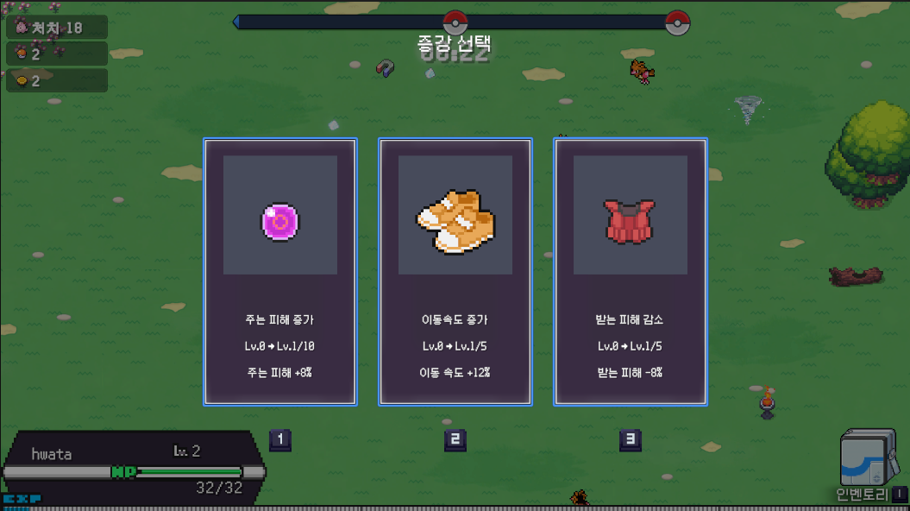

# ImTrainer

**Unity · C# | 2D 탑다운 서바이벌 | 5인 팀 프로젝트**




웨이브로 몰려오는 적을 처치하고, 레벨업마다 증강을 선택하여 캐릭터를 성장시키는 2D 탑다운 서바이벌 게임입니다.

프로젝트 기간 : 2026년 9월 27일 ~ 2026년 10월 21일  
팀 구성 : 클라이언트 개발 3인 / 서버 개발 2인  
담당 포지션 : 클라이언트 개발  

Git을 이용해 협업하였으며, 서버 개발자와 API 규격을 조율하고 클라이언트 기능을 연동했습니다.

## 담당 구현

- 증강 시스템 (JSON 데이터 로딩, 가중치 기반 후보 추첨, 효과 적용)
- HTTP 인증 및 Master Data 동기화 (자동 로그인, Token Refresh, Hash 검증)
- 전투 Object Pool (적 객체 생성, 재사용 및 반환)

---

## 1. 증강 시스템

Flow  
`JSON 로딩 → 후보 추첨 → UI 표시 → 선택 → Level 갱신 및 Effect 적용`

레벨업 시 활성화되는 증강 선택 시스템을 구현했습니다.

JSON에서 불러온 증강 데이터를 런타임에서 별도로 관리하여 게임 진행 중 변경되는 상태와 원본 데이터를 분리하고, 새로운 게임을 시작할 때 초기 상태로 복원할 수 있도록 구성했습니다.

### 선택지 추첨

각 증강의 Weight를 기준으로 후보를 추첨합니다. 추첨된 증강은 후보 목록에서 제거하여 동일한 선택지에 중복으로 등장하지 않도록 했습니다.

최대 Level에 도달한 증강은 GetWeight()에서 0을 반환하여 추첨 대상에서 제외합니다. 또한 에픽 등급 증강을 선택하면 해당 등급의 다른 증강이 이후 후보에 등장하지 않도록 Weight를 변경합니다.


<details>
<summary><b>코드 보기 — 후보 가중치 추첨 (UpgradeManager.RollChoices / PickWeighted)</b></summary>

```csharp
private void RollChoices(int count)
{
    _choices.Clear();
    _candidates.Clear();
    foreach (var definition in _definitions)
    {
        if (GetWeight(definition.Id) > 0f)
        {
            _candidates.Add(definition);
        }
    }

    while (_choices.Count < count && _candidates.Count > 0)
    {
        var picked = PickWeighted(_candidates);
        _choices.Add(picked);
        _candidates.Remove(picked);
    }
}

// 전체 비율에 따른 추첨이기 때문에 random값과 가중치 전체 크기를 곱한다.
// 그 후 리스트 순서대로 가중치값을 감산하여, 랜덤값이 0이하로 내려가는 순간의 데이터를 대상으로 선정하여 return합니다.
private UpgradeDefinition PickWeighted(List<UpgradeDefinition> candidates)
{
    if (candidates.Count == 0)
    {
        return null;
    }

    double totalWeight = 0;
    foreach (var candidate in candidates) totalWeight += GetWeight(candidate.Id);
    var roll = UnityEngine.Random.value * totalWeight;
    for (var i = 0; i < candidates.Count; i++)
    {
        roll -= GetWeight(candidates[i].Id);
        if (roll < 0)
        {
            return candidates[i];
        }
    }

    return candidates[candidates.Count - 1];
}
```

`Assets/Runtime/Scripts/Managers/UpgradeManager.cs`
</details>


### 효과 적용

증강 선택 시 해당 증강의 Level을 증가시키고, UpgradeEffectType에 따라 PlayerManager의 효과 적용 API를 호출합니다.

이동속도, 경험치 획득량, 받는 피해 등의 효과를 같은 선택 흐름에서 처리하도록 구성했습니다. 아래 코드의 Grade 2는 에픽 등급을 나타냅니다.


<details>
<summary><b>코드 보기 — 선택 검증 및 효과 적용 (UpgradeManager.TrySelectChoice)</b></summary>

```csharp
public bool TrySelectChoice(int choiceIndex)
{
    if (!CanSelect() ||
        choiceIndex < 0 ||
        choiceIndex >= _choices.Count)
    {
        return false;
    }

    var chosen = _choices[choiceIndex];

    // 이미 최대 Level에 도달했거나 Weight가 0이면 선택하지 않는다.
    if (GetWeight(chosen.Id) <= 0f)
    {
        return false;
    }

    var previousLevel = GetLevel(chosen.Id);

    // 선택한 Upgrade Level 증가
    _levels[chosen.Id] = previousLevel + 1;


    foreach (var effect in chosen.Effects)
    {
        if (effect.Target != UpgradeTarget.Player)
        {
            continue;
        }

        //각각의 효과에 해당하는 API를 관련 manager를 통해 호출합니다.
        switch (effect.Type)
        {
            case UpgradeEffectType.MoveSpeed:
                _playerManager.AddMoveSpeedMultiplier(_playerManager.LocalPlayerId, effect.Value);
                break;
            case UpgradeEffectType.Experience:
                _playerManager.AddXpMultiplier(_playerManager.LocalPlayerId, effect.Value);
                break;
            case UpgradeEffectType.ReceivedDamage:
                _playerManager.AddReceiveDamageMultiplier(_playerManager.LocalPlayerId, effect.Value);
                break;
            case UpgradeEffectType.Damage:
                _playerManager.AddDamageMultiplier(_playerManager.LocalPlayerId, effect.Value);
                break;
            case UpgradeEffectType.MagnetUpgrade:
                _playerManager.AddMagnetRadius(_playerManager.LocalPlayerId, effect.Value);
                break;
            case UpgradeEffectType.Revive:
                _playerManager.AddRevivalChance(_playerManager.LocalPlayerId, Mathf.RoundToInt(effect.Value));
                break;
            default:
                Debug.LogWarning(
                    $"[증강] 처리되지 않은 Player Effect Type: {effect.Type}",
                    this
                );
                break;
        }
    }

    if (chosen.Grade == 2)
    {
        foreach (var augment in _definitions)
        {
            if(augment.Grade == 2)
            {
                augment.Weight = 0f;
            }
        }
    }


    // Upgrade Sequence 종료
    _active = false;
    Time.timeScale = 1f;
    Managers.Instance.ChangeState(GameState.Playing);

    return true;
}
```

`Assets/Runtime/Scripts/Managers/UpgradeManager.cs`
</details>


---

## 2. HTTP 인증 및 Master Data 동기화

서버와 연동하기 위한 초기 HTTP 통신 구조를 설계하고 구현했습니다.

- `ApiClient` : HTTP 요청 전송 및 응답 반환
- `TokenStorage` : Access Token과 Refresh Token의 로컬 저장 및 관리
- `SplashController` : 자동 로그인, 인증 오류 처리 및 화면 전환

### 자동 로그인 및 Token Refresh

`Token 확인 → Master Data 요청 → 응답 처리 → 로비 진입`

저장된 Access Token을 사용하여 Master Data를 요청합니다. 서버에서 401 Unauthorized가 반환되면 Refresh Token으로 재발급을 요청하고, 성공 시 갱신된 두 Token을 저장한 뒤 새로운 Access Token으로 기존 요청을 한 번 재시도합니다.

재시도 후에도 401이 반환되면 저장된 Token을 삭제하고 오류를 표시합니다. canRefresh 인자를 통해 재발급 이후 동일한 인증 요청이 반복되지 않도록 구성했습니다.


<details>
<summary><b>코드 보기 — 인증 실패 처리 및 Token Refresh (SplashController)</b></summary>

```csharp
// HandleMasterDataResponse() 중 401 응답 처리
if (result.StatusCode == 401)
{
    ErrorResponse error = ParseError(result.Body);

    Debug.Log($"[SplashController] 401 Unauthorized: {error?.message}");

    // Refresh 이후에도 인증이 실패했다면 토큰을 삭제한다.
    if (!canRefresh)
    {
        TokenStorage.Clear();
        ShowError(error?.message ?? "인증에 실패하였습니다.");
        return;
    }

    // 기존 RefreshToken으로 재발급을 시도한다.
    HandleUnauthorized();
    return;
}

private void HandleUnauthorized()
{
    if (!TokenStorage.TryLoad(out _, out string oldRefreshToken))
    {
        ShowTitle();
        return;
    }

    StartCoroutine(_apiClient.PostRequestToken(oldRefreshToken, HandleRefreshResponse));
}

// HandleRefreshResponse() 중 200 응답 처리
if (result.StatusCode == 200)
{
    RefreshTokenResponse response = JsonUtility.FromJson<RefreshTokenResponse>(result.Body);

    if (response == null || string.IsNullOrEmpty(response.accessToken) || string.IsNullOrEmpty(response.refreshToken))
    {
        Debug.LogError("[SplashController] Refresh 응답을 읽지 못했습니다.");
        ShowError("인증 정보를 갱신하지 못했습니다.");
        return;
    }

    TokenStorage.Save(response.accessToken, response.refreshToken);

    Debug.Log("[SplashController] Token 재발급 성공.");

    // 재발급된 accessToken으로 원래 요청을 1회 재시도한다.
    RequestMasterData(response.accessToken, false);

    return;
}

private void RequestMasterData(string accessToken, bool canRefresh)
{
    string requestJson = MasterDataStorage.BuildRequestJson();
    StartCoroutine(_apiClient.PostMasterData(
        accessToken,
        result => HandleMasterDataResponse(result, canRefresh)
        ,requestJson)
        );
}
```

`Assets/Runtime/Scripts/HTTP/SplashController.cs` — 초기 구현 커밋 `ceb838dc`에서 관련 부분 발췌
</details>


### Hash 기반 Master Data 동기화

매번 전체 Master Data를 다운로드하지 않도록 SHA-256 Hash 기반 동기화의 클라이언트 처리를 구현했습니다.

로컬 JSON의 Hash를 계산하여 서버에 전달하고, 서버에서 변경된 데이터를 반환하면 수신 데이터로 계산한 Hash와 서버가 보낸 Hash가 일치하는지 확인한 후 로컬 파일을 갱신합니다.

로컬 데이터가 없으면 Hash 없이 요청하며, 변경 데이터가 반환되지 않으면 기존 로컬 데이터를 사용합니다.

초기에는 Monster 데이터 동기화를 구현했으며, 이후 다른 팀원이 해당 구조를 5개 Master Data 테이블로 확장했습니다.


<details>
<summary><b>코드 보기 — 로컬 Hash 생성 및 데이터 검증 (MasterDataStorage)</b></summary>

```csharp
public static string BuildRequestJson()
{
    // 저장된 데이터가 없으면 전체 데이터 요청
    if (!TryLoadMonster(out string data))
    {
        return "{\"hashes\":{}}";
    }

    // 로컬 JSON 문자열 자체를 SHA-256으로 계산
    string hash = ComputeHash(data);

    var request = new MasterDataRequest
    {
        hashes = new MasterDataHashes
        {
            monster = hash
        }
    };

    return JsonUtility.ToJson(request);
}

public static bool TrySaveMonster(MasterDataEntry entry)
{
    if (entry == null ||
        string.IsNullOrWhiteSpace(entry.data) ||
        string.IsNullOrEmpty(entry.hash))
    {
        return false;
    }

    // 서버에서 받은 데이터와 Hash가 일치하는지 확인
    string calculatedHash = ComputeHash(entry.data);

    if (!string.Equals(
        calculatedHash,
        entry.hash,
        StringComparison.OrdinalIgnoreCase))
    {
        Debug.LogError("[MasterDataStorage] Monster Hash 불일치");
        return false;
    }

    try
    {
        // 서버에서 받은 JSON 문자열을 변경 없이 저장한다.
        File.WriteAllText(
            MonsterPath,
            entry.data,
            new UTF8Encoding(false)
        );

        return true;
    }
    catch (Exception e)
    {
        Debug.LogError($"[MasterDataStorage] 저장 실패: {e.Message}");
        return false;
    }
}

private static string ComputeHash(string data)
{
    byte[] bytes = Encoding.UTF8.GetBytes(data);

    using SHA256 sha = SHA256.Create();

    byte[] hashBytes = sha.ComputeHash(bytes);

    return BitConverter.ToString(hashBytes)
        .Replace("-", "")
        .ToLowerInvariant();
}
```

`Assets/Runtime/Scripts/HTTP/MasterDataStorage.cs` — 초기 구현 커밋 `ceb838dc`에서 관련 부분 발췌
</details>


---

## 3. 전투 Object Pool

전투 중 반복적으로 생성되는 적 객체를 재사용하기 위해 Prefab 기반 Object Pool을 구현했습니다.

CombatObjectPool은 적 Prefab별로 사용 가능한 객체를 Stack에 보관하고, 현재 대여 중인 객체를 HashSet으로 추적합니다.

`Get → 객체 초기화 및 사용 → 상태 정리 → Return`

Get()은 사용 가능한 객체가 있으면 재사용하고, 없으면 새로 생성합니다.

Return()은 현재 대여 중인 객체인지 확인한 뒤 비활성화하여 보관합니다. HashSet.Remove()의 결과를 이용하여 중복 반환과 다른 Pool에 속한 객체의 반환을 방지합니다.

적의 전투 상태 및 사망 처리는 EnemyManager가 담당하고, CombatObjectPool은 객체의 생성·재사용·반환을 관리하도록 역할을 분리했습니다. Scene 종료 시에는 DestroyAll()을 통해 Pool에서 관리하는 객체와 Root를 정리합니다.


<details>
<summary><b>`Assets/Runtime/Scripts/Enemy/CombatObjectPool.cs`</b></summary>

```csharp
using System.Collections.Generic;
using UnityEngine;

/// <summary>
/// Prefab별 객체 생성, 재사용, 반환을 담당한다. Enemy 상태와 Spawn 조건은 관리하지 않는다.
/// 흐름: Get(prefab, position) => 재사용 또는 최초 생성 => 활성화 => 호출자가 초기화.
/// 반환: 호출자가 상태 정리 => Return => 비활성 보관. Scene 종료 시 DestroyAll로 정리한다.
/// </summary>
public sealed class CombatObjectPool
{
    private readonly Dictionary<GameObject, Stack<GameObject>> _available = new Dictionary<GameObject, Stack<GameObject>>();
    private readonly Dictionary<GameObject, GameObject> _prefabs = new Dictionary<GameObject, GameObject>();
    private readonly HashSet<GameObject> _inUse = new HashSet<GameObject>();
    private readonly Transform _root;
    private bool _disposed;

    public Transform Root => _root;

    public CombatObjectPool(Transform stageRoot)
    {
        _root = new GameObject("CombatObjectPool").transform;
        // 기존 Enemy의 World 좌표/크기를 유지하며 게임 Scene에 수명을 묶는다.
        _root.SetParent(stageRoot, true);
    }

    /// <summary>
    /// 같은 Prefab의 비활성 객체를 재사용하거나 생성하여 지정 위치에서 활성화한다.
    /// 호출자는 반환 직후 Bind/Initialize를 끝내고 Tick 대상에 등록한다.
    /// </summary>
    public GameObject Get(GameObject prefab, Vector3 position, Quaternion rotation)
    {
        if (_disposed || _root == null || prefab == null)
        {
            return null;
        }

        if (!_available.TryGetValue(prefab, out var available))
        {
            available = new Stack<GameObject>();
            _available.Add(prefab, available);
        }

        GameObject instance = null;
        while (available.Count > 0 && instance == null)
        {
            instance = available.Pop();
            if (instance == null)
            {
                // Scene 정리 등으로 이미 파괴된 Unity Object 참조는 재사용하지 않는다.
                _prefabs.Remove(instance);
            }
        }

        if (instance == null)
        {
            instance = Object.Instantiate(prefab, position, rotation, _root);
            _prefabs.Add(instance, prefab);
        }

        instance.transform.SetParent(_root, false);
        instance.transform.SetPositionAndRotation(position, rotation);
        instance.transform.localScale = prefab.transform.localScale;
        _inUse.Add(instance);
        instance.SetActive(true);
        return instance;
    }

    /// <summary>
    /// 보관 수가 count가 될 때까지 미리 만들어 비활성으로 둔다.
    /// </summary>
    public void Prewarm(GameObject prefab, int count)
    {
        if (_disposed || _root == null || prefab == null)
        {
            return;
        }

        if (!_available.TryGetValue(prefab, out var available))
        {
            available = new Stack<GameObject>();
            _available.Add(prefab, available);
        }

        for (var i = available.Count; i < count; i++)
        {
            var instance = Object.Instantiate(prefab, _root);
            instance.SetActive(false);
            _prefabs.Add(instance, prefab);
            available.Push(instance);
        }
    }

    /// <summary>
    /// 호출자가 상태를 정리한 객체를 비활성화해 원래 Prefab의 Pool에 돌려놓는다.
    /// 중복 반환, 다른 Pool의 객체, null/파괴된 객체는 false를 반환한다.
    /// </summary>
    public bool Return(GameObject instance)
    {
        if (_disposed || instance == null || !_inUse.Remove(instance))
        {
            return false;
        }

        instance.SetActive(false);
        if (_root != null)
        {
            instance.transform.SetParent(_root, false);
        }

        var prefab = _prefabs[instance];
        if (prefab != null)
        {
            _available[prefab].Push(instance);
        }

        return true;
    }

    /// <summary>
    /// Scene을 떠날 때 보관 중인 객체와 Root를 파괴한다. 이후 Get은 사용할 수 없다.
    /// EnemyManager는 이 메서드 전에 활성 Enemy를 정상 반환하여 Owner를 해제한다.
    /// </summary>
    public void DestroyAll()
    {
        if (_disposed)
        {
            return;
        }

        _disposed = true;
        foreach (var instance in _prefabs.Keys)
        {
            if (instance != null)
            {
                instance.SetActive(false);
                Object.Destroy(instance);
            }
        }

        _inUse.Clear();
        _prefabs.Clear();
        _available.Clear();
        if (_root != null)
        {
            // Prefab 미지정 시 사용하는 비활성 자리표시 원본도 함께 정리된다.
            Object.Destroy(_root.gameObject);
        }
    }
}
```

</details>


---

## 회고

이번 프로젝트에서는 여러 개발자가 동시에 기능을 구현하는 과정에서 시스템의 역할과 인터페이스를 명확히 정의하고 공유하는 것이 중요하다는 점을 경험했습니다.

특히 초기 HTTP 인증 및 데이터 동기화 구조가 이후 서버 API와 데이터 테이블의 확장에 활용되는 과정을 경험했습니다.

반면 Object Pool은 개발 초기 예상 규모에 맞춰 도입했으나, 실제 게임플레이에서 성능 개선 효과를 확정할 만큼 충분한 측정과 검증을 수행하지 못했습니다.

---

코드는 설명에 필요한 부분만 발췌했습니다. 전체 코드는 팀 저장소에 있으며, 사용한 Asset의 저작권 관련 문제를 고려하여 팀 저장소는 Private으로 설정되어 있습니다.
