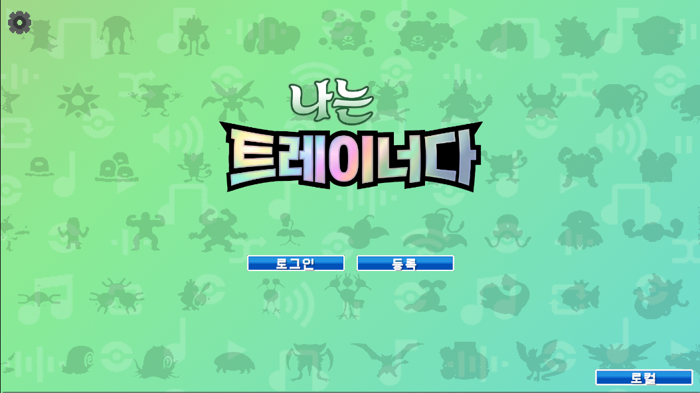

# ImTrainer

**Unity · C# | 2D 탑다운 서바이벌 | 5인 팀 프로젝트**




웨이브로 몰려오는 적을 잡고, 레벨업할 때마다 증강을 골라 캐릭터를 키우는 2D 탑다운 서바이벌 게임입니다.


프로젝트 기간 : 2026년 9월 27일 ~ 2026년 10월 21일  
팀 구성 : 클라이언트 개발 3인 / 서버 개발 2인  
담당 포지션 : 클라이언트 개발  
git을 이용하여 협업하였고, 정기적으로 매주 월요일, 그리고 필요에 따라 비정기 회의를 소집하여 개발 진행 사항과 특히 서버와 클라이언트간 조율과 피드백을 진행하였습니다.
클라이언트 개발은 정기회의 직후 추가적으로 자체 회의를 실시하여, 그 주에 새로 추가할 기능들을 논의하였고, 그중에 각자 구현하길 원하는 기능들을 선택하여 구현하는 방식으로 개발되었습니다.


## 담당 구현

- 증강 시스템 (데이터 로딩, 후보 추첨, 효과 적용)
- 오브젝트 풀

---


## 1. 증강 시스템

Flow
`JSON형태의 증강 base data 로딩 → 후보 N개 추첨 → UI 표시 → 선택 → Level 갱신 및 Effect 적용`

레벨업과 동시에 활성화 됩니다.
training manager의 현재 증강 선택지 갯수 필드를 선택지 출력 함수의 인자로 사용합니다.

JSON에서 로딩한 증강 데이터를 별도의 런타임 데이터로 복사하여 관리합니다. 이를 통해 게임 진행 중 변경되는 증강 상태와 원본 데이터를 분리하고, 매 게임 시작 시 초기 상태로 복원할 수 있도록 구성했습니다.

선택지 선정 과정에서 weight값을 기반으로 대상 데이터를 랜덤하게 추첨하고, 참조를 가져와서 선택지 관리를 위한 리스트에 저장합니다.

증강 선택이 완료되면 선택한 증강의 레벨을 증가시키고, 효과 종류(enum으로 관리)를 통해 효과 처리 방식을 결정, 구체적인 수치들을 적용시킵니다.

또한 증강 레벨이 최대치에 도달하거나, 다른 조건의 선택지를 막는 임의의 증강의 경우, 선택한 이후 지정한 증강들의 weight값을 조정하는 처리가 더해집니다.


### 선택지 추첨
weight값을 기반으로 추첨합니다.

<details>
<summary><b>코드 보기 — 후보 가중치 추첨 (UpgradeManager.RollChoices / PickWeighted)</b></summary>

```csharp
private void RollChoices(int count)
{
    _choices.Clear();
    _candidates.Clear();
    foreach (var definition in _definitions)
    {
        if (GetWeight(definition.Id) > 0f)
        {
            _candidates.Add(definition);
        }
    }

    while (_choices.Count < count && _candidates.Count > 0)
    {
        var picked = PickWeighted(_candidates);
        _choices.Add(picked);
        _candidates.Remove(picked);
    }
}

// 전체 비율에 따른 추첨이기 때문에 random값과 가중치 전체 크기를 곱한다.
// 그 후 리스트 순서대로 가중치값을 감산하여, 랜덤값이 0이하로 내려가는 순간의 데이터를 대상으로 선정하여 return합니다.
private UpgradeDefinition PickWeighted(List<UpgradeDefinition> candidates)
{
    if (candidates.Count == 0)
    {
        return null;
    }

    double totalWeight = 0;
    foreach (var candidate in candidates) totalWeight += GetWeight(candidate.Id);
    var roll = UnityEngine.Random.value * totalWeight;
    for (var i = 0; i < candidates.Count; i++)
    {
        roll -= GetWeight(candidates[i].Id);
        if (roll < 0)
        {
            return candidates[i];
        }
    }

    return candidates[candidates.Count - 1];
}
```

`Assets/Runtime/Scripts/Managers/UpgradeManager.cs`
</details>

### 효과의 처리
효과의 종류를 사전에 enum으로 정의해놓았고, 각각에 대한 처리를 switch문으로 분기하였습니다.

<details>
<summary><b>코드 보기 — 선택 검증 및 효과 적용 (UpgradeManager.TrySelectChoice)</b></summary>

```csharp
public bool TrySelectChoice(int choiceIndex)
{
    if (!CanSelect() ||
        choiceIndex < 0 ||
        choiceIndex >= _choices.Count)
    {
        return false;
    }

    var chosen = _choices[choiceIndex];

    // 이미 최대 Level에 도달했거나 Weight가 0이면 선택하지 않는다.
    if (GetWeight(chosen.Id) <= 0f)
    {
        return false;
    }

    var previousLevel = GetLevel(chosen.Id);

    // 선택한 Upgrade Level 증가
    _levels[chosen.Id] = previousLevel + 1;


    foreach (var effect in chosen.Effects)
    {
        if (effect.Target != UpgradeTarget.Player)
        {
            continue;
        }

        //각각의 효과에 해당하는 API를 관련 manager를 통해 호출합니다.
        switch (effect.Type)
        {
            case UpgradeEffectType.MoveSpeed:
                _playerManager.AddMoveSpeedMultiplier(_playerManager.LocalPlayerId, effect.Value);
                break;
            case UpgradeEffectType.Experience:
                _playerManager.AddXpMultiplier(_playerManager.LocalPlayerId, effect.Value);
                break;
            case UpgradeEffectType.ReceivedDamage:
                _playerManager.AddReceiveDamageMultiplier(_playerManager.LocalPlayerId, effect.Value);
                break;
            case UpgradeEffectType.Damage:
                _playerManager.AddDamageMultiplier(_playerManager.LocalPlayerId, effect.Value);
                break;
            case UpgradeEffectType.MagnetUpgrade:
                _playerManager.AddMagnetRadius(_playerManager.LocalPlayerId, effect.Value);
                break;
            case UpgradeEffectType.Revive:
                _playerManager.AddRevivalChance(_playerManager.LocalPlayerId, Mathf.RoundToInt(effect.Value));
                break;
            default:
                Debug.LogWarning(
                    $"[증강] 처리되지 않은 Player Effect Type: {effect.Type}",
                    this
                );
                break;
        }
    }

    if (chosen.Grade == 2)
    {
        foreach (var augment in _definitions)
        {
            if(augment.Grade == 2)
            {
                augment.Weight = 0f;
            }
        }
    }


    // Upgrade Sequence 종료
    _active = false;
    Time.timeScale = 1f;
    Managers.Instance.ChangeState(GameState.Playing);

    return true;
}
```

`Assets/Runtime/Scripts/Managers/UpgradeManager.cs`
</details>

---


## 2. 전투 오브젝트 풀

Prefab을 기준으로 전투 객체의 생성, 재사용 및 반환을 관리하는 Object Pool을 구현했습니다.
최초 기획당시, 오브젝트 풀의 적용 범위를 enemy, projectile, maptile등등 넓은 범위로 사용 될 것을 상정하고 만들어졌기 때문에 prefab을 기준으로 리스트를 나눠서 관리하게 구현하였습니다.
`CombatObjectPool`은 적 Prefab별로 쓰지 않는 객체를 Stack에 보관하고, 대여 중인 객체를 따로 추적합니다. 투사체는 `EnemyManager`에서 별도로 재사용합니다.
따라서 실질적인 전투 상태 관리는 `EnemyManager`가 하고, `CombatObjectPool`은 객체 재사용과 반환만 맡습니다.

`Pool.Get → Enemy 초기화 및 사용 → 사망 후 상태 정리 → Pool.Return → 비활성 객체 재보관`

`Return`은 대여 중인 객체 집합에서 제거하는 데 성공했을 때만 처리합니다. 그래서 같은 객체를 두 번 반환해도 Stack에는 한 번만 들어갑니다.

기획 당시엔 굉장히 큰 규모로 wave가 만들어질것으로 전망이 되어 개발 초기단계에서 미리 구현된 시스템이었습니다.
실제 게임플레이 A/B 테스트에서는 평균 Frame Time이 Pool ON 17.686ms, OFF 18.658ms로 ON에서 약 5.2% 낮게 관측되었습니다. 다만 측정 회수와 실행별 변동폭을 고려하면, Pooling으로 인한 성능 향상을 확정할 수는 없었습니다.

**Test PC 환경**

- OS: Windows 11 Pro
- CPU: Intel Core i7-8750H (6C/12T)
- GPU: NVIDIA GeForce GTX 1060
- RAM: 16GB
- Storage: SATA SSD

<details>
<summary><b>`Assets/Runtime/Scripts/Enemy/CombatObjectPool.cs`</b></summary>

```csharp
using System.Collections.Generic;
using UnityEngine;

/// <summary>
/// Prefab별 객체 생성, 재사용, 반환을 담당한다. Enemy 상태와 Spawn 조건은 관리하지 않는다.
/// 흐름: Get(prefab, position) => 재사용 또는 최초 생성 => 활성화 => 호출자가 초기화.
/// 반환: 호출자가 상태 정리 => Return => 비활성 보관. Scene 종료 시 DestroyAll로 정리한다.
/// </summary>
public sealed class CombatObjectPool
{
    private readonly Dictionary<GameObject, Stack<GameObject>> _available = new Dictionary<GameObject, Stack<GameObject>>();
    private readonly Dictionary<GameObject, GameObject> _prefabs = new Dictionary<GameObject, GameObject>();
    private readonly HashSet<GameObject> _inUse = new HashSet<GameObject>();
    private readonly Transform _root;
    private bool _disposed;

    public Transform Root => _root;

    public CombatObjectPool(Transform stageRoot)
    {
        _root = new GameObject("CombatObjectPool").transform;
        // 기존 Enemy의 World 좌표/크기를 유지하며 게임 Scene에 수명을 묶는다.
        _root.SetParent(stageRoot, true);
    }

    /// <summary>
    /// 같은 Prefab의 비활성 객체를 재사용하거나 생성하여 지정 위치에서 활성화한다.
    /// 호출자는 반환 직후 Bind/Initialize를 끝내고 Tick 대상에 등록한다.
    /// </summary>
    public GameObject Get(GameObject prefab, Vector3 position, Quaternion rotation)
    {
        if (_disposed || _root == null || prefab == null)
        {
            return null;
        }

        if (!_available.TryGetValue(prefab, out var available))
        {
            available = new Stack<GameObject>();
            _available.Add(prefab, available);
        }

        GameObject instance = null;
        while (available.Count > 0 && instance == null)
        {
            instance = available.Pop();
            if (instance == null)
            {
                // Scene 정리 등으로 이미 파괴된 Unity Object 참조는 재사용하지 않는다.
                _prefabs.Remove(instance);
            }
        }

        if (instance == null)
        {
            instance = Object.Instantiate(prefab, position, rotation, _root);
            _prefabs.Add(instance, prefab);
        }

        instance.transform.SetParent(_root, false);
        instance.transform.SetPositionAndRotation(position, rotation);
        instance.transform.localScale = prefab.transform.localScale;
        _inUse.Add(instance);
        instance.SetActive(true);
        return instance;
    }

    /// <summary>
    /// 보관 수가 count가 될 때까지 미리 만들어 비활성으로 둔다.
    /// </summary>
    public void Prewarm(GameObject prefab, int count)
    {
        if (_disposed || _root == null || prefab == null)
        {
            return;
        }

        if (!_available.TryGetValue(prefab, out var available))
        {
            available = new Stack<GameObject>();
            _available.Add(prefab, available);
        }

        for (var i = available.Count; i < count; i++)
        {
            var instance = Object.Instantiate(prefab, _root);
            instance.SetActive(false);
            _prefabs.Add(instance, prefab);
            available.Push(instance);
        }
    }

    /// <summary>
    /// 호출자가 상태를 정리한 객체를 비활성화해 원래 Prefab의 Pool에 돌려놓는다.
    /// 중복 반환, 다른 Pool의 객체, null/파괴된 객체는 false를 반환한다.
    /// </summary>
    public bool Return(GameObject instance)
    {
        if (_disposed || instance == null || !_inUse.Remove(instance))
        {
            return false;
        }

        instance.SetActive(false);
        if (_root != null)
        {
            instance.transform.SetParent(_root, false);
        }

        var prefab = _prefabs[instance];
        if (prefab != null)
        {
            _available[prefab].Push(instance);
        }

        return true;
    }

    /// <summary>
    /// Scene을 떠날 때 보관 중인 객체와 Root를 파괴한다. 이후 Get은 사용할 수 없다.
    /// EnemyManager는 이 메서드 전에 활성 Enemy를 정상 반환하여 Owner를 해제한다.
    /// </summary>
    public void DestroyAll()
    {
        if (_disposed)
        {
            return;
        }

        _disposed = true;
        foreach (var instance in _prefabs.Keys)
        {
            if (instance != null)
            {
                instance.SetActive(false);
                Object.Destroy(instance);
            }
        }

        _inUse.Clear();
        _prefabs.Clear();
        _available.Clear();
        if (_root != null)
        {
            // Prefab 미지정 시 사용하는 비활성 자리표시 원본도 함께 정리된다.
            Object.Destroy(_root.gameObject);
        }
    }
}
```

</details>

---

## 회고
이번 프로젝트에서는 개발 초기 회의를 통해 주요 시스템의 역할과 담당 Manager를 구분하고 구현을 시작했습니다.

기획 단계에서 결정된 게임의 핵심 기능을 기준으로 각 시스템의 책임과 의존 관계를 정리하고, 이를 관리할 Manager Class를 먼저 구성한 뒤 세부 기능을 구현했습니다.

덕분에 각자 개발한 기능을 통합하는 과정에서 시스템 간 연결 지점을 파악하고 필요한 기능을 추가하기가 비교적 수월했습니다.

여러 개발자가 협업하는 환경에서는 개발 초기부터 시스템의 책임과 관계를 명확하게 정의하고 공유하는 것이 중요하다는 점을 경험했습니다.


---

코드는 설명에 필요한 부분만 발췌한 것이고, 전체 코드는 팀 저장소에 있습니다. → https://github.com/SpartaTeam2Project/Client_ImTrainer (프로젝트는 사용한 asset의 저작권 관련 문제를 우려하여 공개수준이 private으로 설정되어있습니다.)
