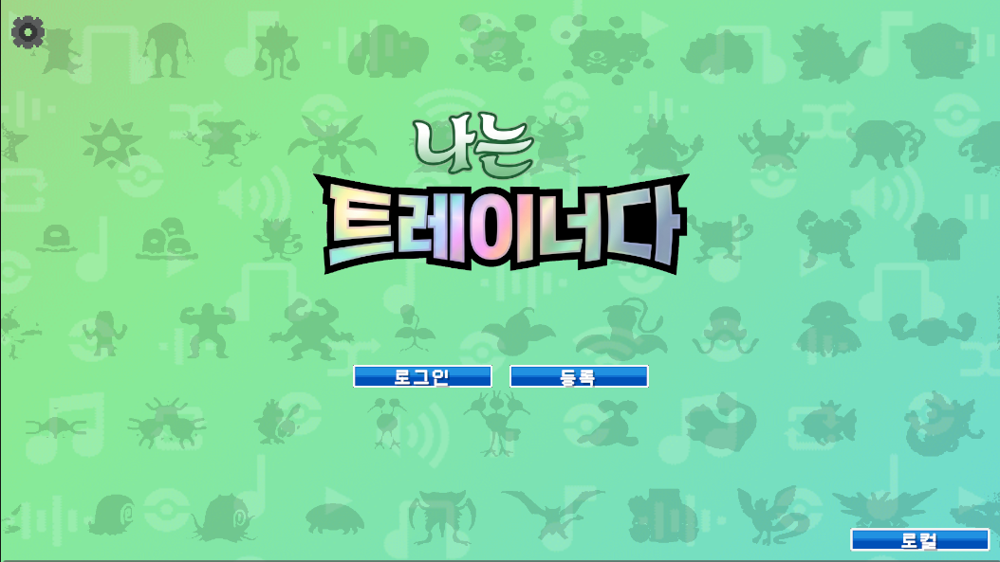
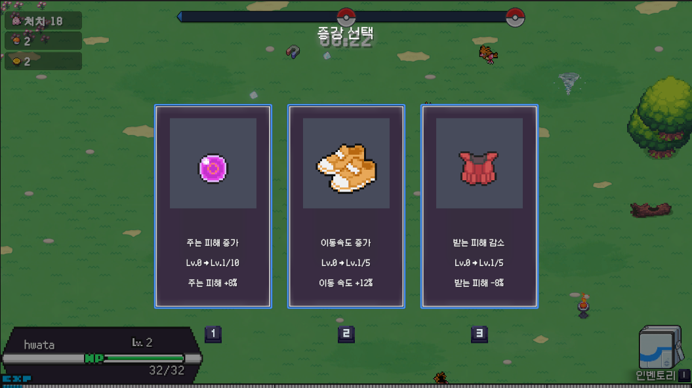

# ImTrainer

**Unity · C# | 2D 탑다운 서바이벌 | 5인 팀 프로젝트**




웨이브로 몰려오는 적을 잡고, 레벨업할 때마다 증강을 골라 캐릭터를 키우는 2D 탑다운 서바이벌 게임입니다.


프로젝트 기간 : 2026년 9월 27일 ~ 2026년 10월 21일  
팀 구성 : 클라이언트 개발 3인 / 서버 개발 2인  
담당 포지션 : 클라이언트 개발  
git을 이용하여 협업하였고, 정기적으로 매주 월요일, 그리고 필요에 따라 비정기 회의를 소집하여 개발 진행 사항과 특히 서버와 클라이언트간 조율과 피드백을 진행하였습니다.
클라이언트 개발은 정기회의 직후 추가적으로 자체 회의를 실시하여, 그 주에 새로 추가할 기능들을 논의하였고, 그중에 각자 구현하길 원하는 기능들을 선택하여 구현하는 방식으로 개발되었습니다.


## 담당 구현

- 증강 시스템 (데이터 로딩, 후보 추첨, 효과 적용)
- 적 스폰 및 관리(레벨 디자인)
- 전투 오브젝트 풀

---

## 1. 증강 시스템

레벨업하면 기본적으로 증강 후보 3개를 뽑아 보여주고, 플레이어가 고른 증강의 효과를 능력치에 반영합니다. 증강 데이터, 선택 결과, 효과는 `UpgradeManager`가 맡습니다.

`JSON형태의 증강 base data 로딩
→ 후보 N개 추첨
→ UI 표시
→ 선택
→ Level 갱신 및 Effect 적용`

base data 로딩 : runtime에 data를 올려서 JSON 원본파일을 수정하지 않습니다
후보 N개 추첨 : weight값 및 특정 조건 기반 추첨, 트레이닝이나 다른 시스템을 통해 후보의 갯수에 변동이 생길 수 있습니다. 선정된 증강 data는 별도의 리스트에 데이터를 복사하여 관리합니다. 다음 레벨업 시점이나 reroll chance를 사용하기 전까지 리스트에 변동은 생기지 않습니다.
UI 표시 : effect list의 effects 배열 내부의 데이터를 분석하여 실제 적용되는 수치와 효과, 증강 이름과 더불어 증강 data가 명시하고있는 경로를 따라 들어가 해당하는 증강 이미지를 화면에 표시합니다.
level 갱신 및 Effect 적용 : upgrade manager에서 앞서 전달받았던 증강 데이터, 선택 결과를 받아 해당 명령을 바탕으로 구체적인 효과의 처리를 관련 manager들의 API 호출을 통해 적용하게 됩니다. 증강 효과를 적용할 때 upgrade manager가 객체의 필드를 직접적으로 참조하거나 객체를 직접적으로 참조하지 않고 반드시 관리객체인 manager들을 호출하여 처리하도록 하였습니다. 때문에 구체적인 효과 적용이 어떤방식으로 이루어지는지는 관리객체 manager들의 API내부 구현에 의존하게 되고 외부 system은 객체 내부 구현 사항과 독립된 형태로 동작하게 되는 구조를 의도하였습니다.


최초 기획에서 결정된 사항으로는, 증강에 대한 데이터를 서버에 저장하여, 진행한 Run의 유효성을 검사하는것으로 기획이 되었으나.
서버 개발 상황이 여의치 않아 Json을 이용하여 증강데이터를 관리하는 구조만 남게 되었습니다.
구조를 바꾸는 부분에 대한 회의도 진행되었으나, 구현된 시스템으로 증강 데이터를 추가 및 제거하는것이 간편하여 구조를 유지하는 것으로 결정되었습니다.

구현된 증강들은 모두 playerManager가 관리하는 스크립트와 관련이 되어있습니다.
다른 시스템에서 player에 영향을 미치기 위해 필요한 효과를 playerManager를 통해 적용할 수 있도록 API를 만들어 각각의 시스템에 연결했습니다.
UpgradeManager는 해당 API를 이용하여 구현되었기 때문에 효과를 적용할 때 세부 구현을 알 필요가 없게됩니다.

### 후보 뽑기

후보마다 현재 `Weight`를 가지고 가중치 추첨을 합니다. 실제 선택지 개수는 `RollChoices()`에 전달되는 `count`를 따릅니다. 한 번 뽑힌 증강은 같은 선택 화면에서 다시 나오지 않도록 후보 목록에서 빼고, 최대 Level에 도달했거나 조건이 안 맞는 증강은 `GetWeight()`가 0을 반환해서 처음부터 후보에 들어가지 않습니다.

후보를 추첨하는 시스템은 기획단계에서 단계별 증강 업그레이드나, 증강 트리같은 컨텐츠들이 언급이 되어 조건검사를 통해 가중치에 변화를 주는 구현을 하였습니다.
실제로, 최종 결과물에도 테이블에 존재하는 기본 증강들을 모두 최종레벨까지 달성하였을때에 해금되는 한계 돌파 증강, 그리고 게임중에 단 하나만 찍을 수 있는 에픽 증강 시스템을 도입하여 테이블을 유동적으로 관리하였습니다.

<details>
<summary><b>코드 보기 — 후보 가중치 추첨 (UpgradeManager.RollChoices / PickWeighted)</b></summary>

```csharp
private void RollChoices(int count)
{
    _choices.Clear();
    _candidates.Clear();
    foreach (var definition in _definitions)
    {
        if (GetWeight(definition.Id) > 0f)
        {
            _candidates.Add(definition);
        }
    }

    while (_choices.Count < count && _candidates.Count > 0)
    {
        var picked = PickWeighted(_candidates);
        _choices.Add(picked);
        _candidates.Remove(picked);
    }
}

// 가중치 비례로 하나를 고른다. Random.value가 1일 때는 마지막 후보다.
private UpgradeDefinition PickWeighted(List<UpgradeDefinition> candidates)
{
    if (candidates.Count == 0)
    {
        return null;
    }

    double totalWeight = 0;
    foreach (var candidate in candidates) totalWeight += GetWeight(candidate.Id);
    var roll = UnityEngine.Random.value * totalWeight;
    for (var i = 0; i < candidates.Count; i++)
    {
        roll -= GetWeight(candidates[i].Id);
        if (roll < 0)
        {
            return candidates[i];
        }
    }

    return candidates[candidates.Count - 1];
}
```

`Assets/Runtime/Scripts/Managers/UpgradeManager.cs`
</details>

### 효과 적용

카드를 누르면 `TrySelectChoice`가 선택 인덱스와 현재 선택 가능 상태를 확인하고, 증강 Level을 올린 뒤 Effect 종류에 따라 `PlayerManager`에 통해 적절한 API 호출 및 데이터를 전달합니다.

Effect에 대한 데이터를 정의하는 데이터 클래스를 만들고 각 효과에 대한 데이터 처리 방법을 다르게 하기위해 Effect의 종류는 enum으로 만들어 관리하였습니다.
증강데이터에서 파싱한 effect list의 효과 목록을 순회하며 각각의 효과에 대한 개별 수치를 받아 switch문으로 처리하였습니다.

Effect외에도 특정 조건을 만족할경우 조건에 맞는 증강들을 막는 구현은 관리하는 시스템이 아닌 개별적으로 하드코딩하여 구현하게 되었습니다.
예시로 에픽등급에 해당하는 Grade 2 한 판에 하나만 가질 수 있는 상위 증강이라서, 하나를 고르면 나머지는 후보에서 빠지게 했습니다.

UI는 능력치를 직접 건드리지 않고 플레이어가 어떤 데이터를 선택했는지 upgrade manager에 전달합니다.
효과의 실행은 upgrade manager가 관련 메서드를 통해  분석하여 적절한 효과를 적용하는 flow로 구현하였습니다.


<details>
<summary><b>코드 보기 — 선택 검증 및 효과 적용 (UpgradeManager.TrySelectChoice)</b></summary>

```csharp
public bool TrySelectChoice(int choiceIndex)
{
    if (!CanSelect() ||
        choiceIndex < 0 ||
        choiceIndex >= _choices.Count)
    {
        return false;
    }

    var chosen = _choices[choiceIndex];

    // 이미 최대 Level에 도달했거나 Weight가 0이면 선택하지 않는다.
    if (GetWeight(chosen.Id) <= 0f)
    {
        return false;
    }

    var previousLevel = GetLevel(chosen.Id);

    // 선택한 Upgrade Level 증가
    _levels[chosen.Id] = previousLevel + 1;


    foreach (var effect in chosen.Effects)
    {
        if (effect.Target != UpgradeTarget.Player)
        {
            continue;
        }

        //각각의 효과에 해당하는 API를 관련 manager를 통해 호출합니다.
        switch (effect.Type)
        {
            case UpgradeEffectType.MoveSpeed:
                _playerManager.AddMoveSpeedMultiplier(_playerManager.LocalPlayerId, effect.Value);
                break;
            case UpgradeEffectType.Experience:
                _playerManager.AddXpMultiplier(_playerManager.LocalPlayerId, effect.Value);
                break;
            case UpgradeEffectType.ReceivedDamage:
                _playerManager.AddReceiveDamageMultiplier(_playerManager.LocalPlayerId, effect.Value);
                break;
            case UpgradeEffectType.Damage:
                _playerManager.AddDamageMultiplier(_playerManager.LocalPlayerId, effect.Value);
                break;
            case UpgradeEffectType.MagnetUpgrade:
                _playerManager.AddMagnetRadius(_playerManager.LocalPlayerId, effect.Value);
                break;
            case UpgradeEffectType.Revive:
                _playerManager.AddRevivalChance(_playerManager.LocalPlayerId, Mathf.RoundToInt(effect.Value));
                break;
            default:
                Debug.LogWarning(
                    $"[증강] 처리되지 않은 Player Effect Type: {effect.Type}",
                    this
                );
                break;
        }
    }

    if (chosen.Grade == 2)
    {
        foreach (var augment in _definitions)
        {
            if(augment.Grade == 2)
            {
                augment.Weight = 0f;
            }
        }
    }


    // Upgrade Sequence 종료
    _active = false;
    Time.timeScale = 1f;
    Managers.Instance.ChangeState(GameState.Playing);

    return true;
}
```

`Assets/Runtime/Scripts/Managers/UpgradeManager.cs`
</details>

### UI와 연결되는 지점

선택 화면은 `AugmentWindowBehavior`가 담당합니다. 이 클래스는 매니저가 준비한 `CurrentChoices`를 읽어 카드의 이름, 현재·다음 Level, 효과 설명을 채우고, 카드를 누르면 `TrySelectChoice`를 호출합니다.
TrySelectChoice는 상술한 흐름으로, 해당 선택지에 존재하는 데이터를 적용하는 로직을 실행합니다.

---

## 2. 적 스폰 및 관리

`EnemyManager`가 스폰 요청을 받아 활성 적 목록을 관리합니다. 스테이지가 활성화되어 있지 않거나, 보스전 중이거나, 요청한 플레이어가 맞지 않거나, 이미 최대 활성 수(`MAX_ALIVE`)에 도달했으면 스폰하지 않습니다.

`Wave 요청 → 스폰 위치 결정 → CreateEnemy → Pool.Get → 활성 목록 관리 → 사망 처리 및 반환`

enemy의 스폰은 player 주변의 카메라 화면 밖에서 스폰되도록 하였습니다. (circle wave는 별도 거리 계산)
player의 이동에 따라 카메라 위치가 달라지므로 Spawn Point를 고정하지 않고, 카메라 외곽을 기준으로 후보 위치를 계산한 뒤 `StageFieldManager`를 통해 위치가 유효한지 확인합니다.

실제 runtime중에 생성되는 wave의 설정 및 관리는 팀원이 구현한 timeline기반의 관리 시스템을 사용하였습니다.

레벨 디자인은 중간보스 시점에 최종진화체 1체, 보스 대면 시점에 최종 진화체 3성+최종 진화체 1체 or 최종진화체3체 이상이 파티에 구성되도록 자원 수급량을 직접 플레이를 통한 테스트 기반으로 조정하였습니다.

<details>
<summary><b>코드 보기 — 스폰 위치 결정 (EnemyManager.ResolveSpawnPosition)</b></summary>

```csharp
private Vector2 ResolveSpawnPosition(Vector2 playerPosition, int amount, bool circularSpawn)
{
    var extra = amount > LARGE_SPAWN_AMOUNT ? Mathf.Sqrt(_alive.Count) * LARGE_SPAWN_SPREAD : 0f;
    if (!TryGetCamera(out var camera) || camera.ViewDiagonal <= 0f)
    {
        var angle = UnityEngine.Random.Range(0f, Mathf.PI * 2f);
        return AcceptOrBorder(playerPosition + new Vector2(Mathf.Cos(angle), Mathf.Sin(angle)) * FALLBACK_SPAWN_RADIUS, playerPosition);
    }

    var diagonal = camera.ViewDiagonal;
    var lastCandidate = playerPosition;
    for (var attempt = 0; attempt < SPAWN_POSITION_TRIES; attempt++)
    {
        lastCandidate = circularSpawn
            ? playerPosition + RandomDirection() * (diagonal * CIRCULAR_DISTANCE_MULTIPLIER + UnityEngine.Random.value * CIRCULAR_PADDING_RANDOM + extra)
            : camera.GetRandomPointOutside(SPAWN_OUTSIDE_PADDING + UnityEngine.Random.value * SPAWN_PADDING_RANDOM + extra);
        if (TryAcceptPosition(lastCandidate, out var accepted))
        {
            return accepted;
        }
    }

    return AcceptOrBorder(lastCandidate, playerPosition);
}
```

`Assets/Runtime/Scripts/Managers/EnemyManager.cs`
</details>

---

## 3. 전투 오브젝트 풀

적과 투사체를 매번 만들고 파괴하지 않고 재사용하기 위한 구조입니다. `CombatObjectPool`은 적 Prefab별로 쓰지 않는 객체를 Stack에 보관하고, 대여 중인 객체를 따로 추적합니다. 투사체는 `EnemyManager`에서 별도로 재사용합니다. 전투 상태 관리는 `EnemyManager`가 하고, `CombatObjectPool`은 객체 재사용과 반환만 맡습니다.

`Pool.Get → Enemy 초기화 및 사용 → 사망 후 상태 정리 → Pool.Return → 비활성 객체 재보관`

`Return`은 대여 중인 객체 집합에서 제거하는 데 성공했을 때만 처리합니다. 그래서 같은 객체를 두 번 반환해도 Stack에는 한 번만 들어갑니다.


차별화되는 최적화 알고리즘이 적용되어있지는 않지만, `EnemyManager`가 `_alive` 목록으로 활성화중인 enemy를 관리하고 있어 Collider를 통해 별도의 탐색알고리즘 없이 맵에 존재하는 활성 enemy 전체 정보를 조회할 수 있습니다. 이는 Object Pool 자체가 아닌 활성 적 목록 관리의 역할입니다.

최종빌드에 적용되진 않았지만 이 활성 enemy list를 활용하여 enemy를 미니맵에 표시해보자 같은 다양한 활용 방안이 논의될 수 있었습니다.


기획 당시엔 굉장히 큰 규모로 wave가 만들어질것으로 전망이 되어 개발 초기단계에서 미리 구현된 시스템이었습니다.
실제 게임플레이 A/B 테스트에서는 평균 Frame Time이 Pool ON 17.686ms, OFF 18.658ms로 ON에서 약 5.2% 낮게 관측되었습니다. 다만 측정 회수와 실행별 변동폭을 고려하면, Pooling으로 인한 성능 향상을 확정할 수는 없었습니다.

<details>
<summary><b>코드 보기 — 중복 반환 방지 (CombatObjectPool.Return)</b></summary>

```csharp
public bool Return(GameObject instance)
{
    if (_disposed || instance == null || !_inUse.Remove(instance))
    {
        return false;
    }

    instance.SetActive(false);
    if (_root != null)
    {
        instance.transform.SetParent(_root, false);
    }

    var prefab = _prefabs[instance];
    if (prefab != null)
    {
        _available[prefab].Push(instance);
    }

    return true;
}
```

`Assets/Runtime/Scripts/Enemy/CombatObjectPool.cs`
</details>

### 테스트

Unity Editor Play Mode에서 같은 스테이지의 60~120초 구간을 Pool ON 5회, OFF 5회 측정하였습니다. 평균 활성 Enemy는 ON 45.40마리, OFF 45.80마리였으며, Prewarm 비용은 측정에서 제외하였습니다.

---

## 돌아보며

역할 경계가 명확하지 않은 상황에서 AI 코드리뷰 및 git 관리, 그리고 manager와 연동되는 시스템 구현시 구현 담당자와의 코드 리뷰를 통해 서로의 구현 영역을 교차 확인하였고.  충돌 없이 병렬로 개발할 수 있었습니다.

---

코드는 설명에 필요한 부분만 발췌한 것이고, 전체 코드는 팀 저장소에 있습니다. → https://github.com/SpartaTeam2Project/Client_ImTrainer (프로젝트는 사용한 asset의 저작권 관련 문제를 우려하여 공개수준이 private으로 설정되어있습니다.)
